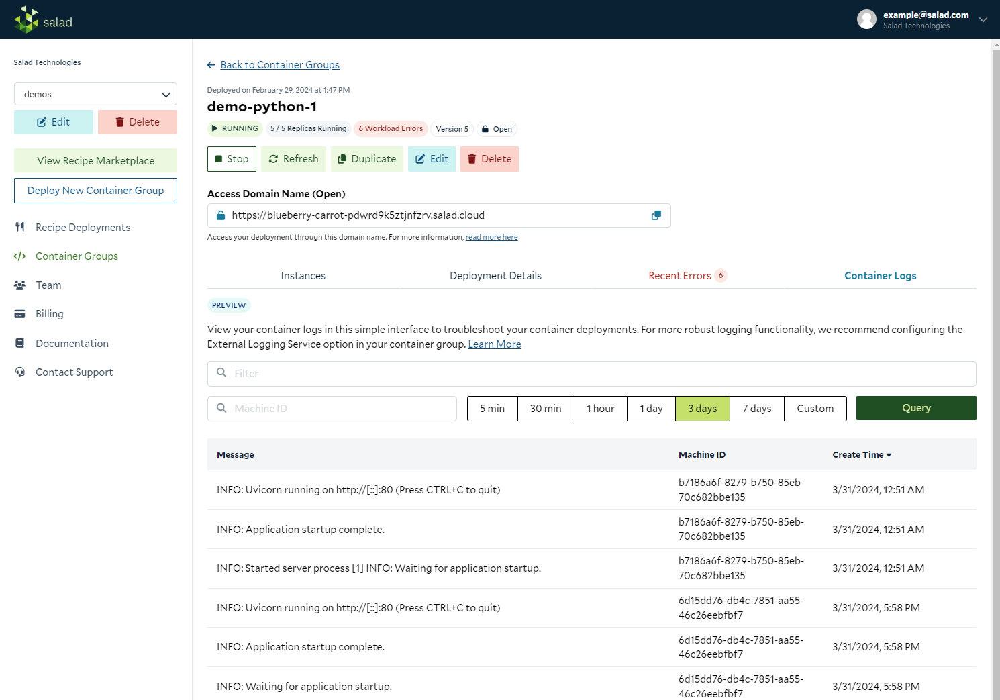
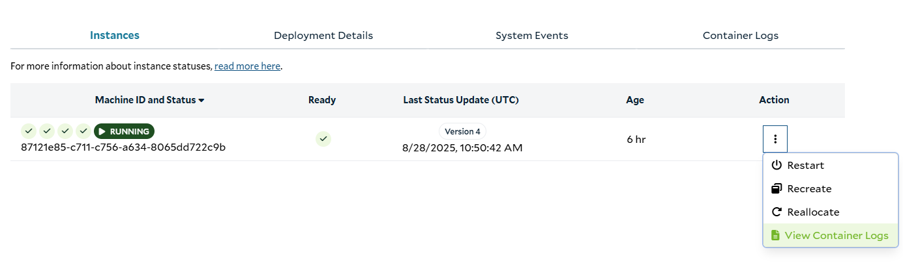
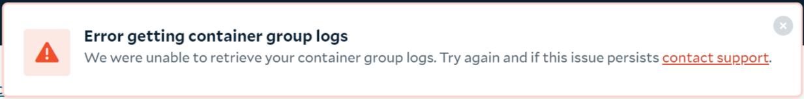

_Last Updated: November 12, 2026_

## How to Log From Your Container

When running a container on SaladCloud, you can log to the standard output and standard error streams. These logs are
collected and stored by SaladCloud, and exported to any configured
[external logging source](/container-engine/explanation/infrastructure-platform/external-logging).

[Learn more about logging best practices.](/container-engine/how-to-guides/external-logging/best-practices)

## Basic Logging

### How to View Container Logs In the Portal

Once your container is up and running on a SaladCloud node, you can view the logs from your container on the "Container
Logs" tab of a Container Group. To access this feature in the portal, navigate to your Container Group details page, and
click on the 'Container Logs' tab.



You can also navigate to this page from the Action menu of an instance. This option will take you to the Container Logs
tab with the Machine ID value pre-filled.



The Container Logs feature has a simple interface meant to provide you with enough visibility for basic troubleshooting
of your applications running on SaladCloud. For more robust logging functionality, we recommend configuring the
[External Logging Service option](/container-engine/explanation/infrastructure-platform/external-logging) in your
container group.

The Container Logs feature allows you to query your container logs with these options:

- search for specific log messages with case-insensitive string filtering
- filter for logs from a specific Machine ID. If left blank, logs from all Machine IDs in the Container Group will be
  returned.
- filter for logs in a specified time period. Choose one of the predefined options, or use the custom start date and end
  date option

When your query returns results you will see them in a scrollable table view. Each result includes:

- Log Message
- Machine ID (The unique ID of the node running the container that created the log message.)
- Log Create Time

Should your query yield no results, the table view will display "No data to display"

For more sophisticated querying, you can use the Log Explorer or the Public API
[Query Log Entries endpoint](/reference/saladcloud-api/logs/query-log-entries). Clicking the Log Explorer button will
take you to the Log Explorer page in the SaladCloud Portal with the current query pre-populated.

**Availability and Limitations**

- A maximum of 500 logs can be returned per query. Utilize specific query filters and time ranges to get the logs you
  are looking for.
- Logs are retained and accessible for up to 90 days.
- Each query counts against your [daily log query limits](#daily-log-query-limits).
- If you encounter this error message, try narrowing your query's time range
  - 

## Advanced Logging

For more advanced on-platform logging capabilities, you can make use of the
[Query Log Entries endpoint](/reference/saladcloud-api/logs/query-log-entries) in the API. This endpoint is scoped at
the organization level, rather than the container group level, allowing you to view logs from any number of container
groups and projects.

This endpoint supports a more flexible query language as well, allowing you to make much more sophisticated filters
across many fields, and supporting filters on structured logs emitted by your application.
[See the full query reference](/container-engine/reference/log-queries).

You can query logs by making a POST request to the query logs endpoint like this:

```shell
curl --request POST \
  --url https://api.salad.com/api/public/organizations/$organization_name/log-entries \
  --header 'Content-Type: application/json' \
  --header "Salad-Api-Key: $salad_api_key" \
  --data '{
  "end_time": "2025-11-07T05:31:56Z",
  "page_size": 1,
  "query": "<string>",
  "sort_order": "desc",
  "start_time": "2025-11-07T05:31:56Z"
}'
```

and receive a response like:

```json
{
  "items": [
    {
      "json_log": {},
      "parent_span_id": "<string>",
      "receive_time": "2025-11-07T05:31:56Z",
      "resource": {
        "labels": {},
        "type": "<string>"
      },
      "severity": "debug",
      "span_Id": "<string>",
      "time": "2025-11-07T05:31:56Z",
      "trace_Id": "<string>"
    }
  ],
  "organization_name": "acme-corp",
  "page_max_time": "2025-11-07T05:31:56Z",
  "page_min_time": "2025-11-07T05:31:56Z"
}
```

Each log event takes the following structure.

```json
{
  "time": "string iso8601",
  "receive_time": "string iso8601",
  "resource": {
    "type": "string enum",
    "labels": {
      // key-value pairs (string to string) specific to `type`
    }
  },
  "severity": "string enum",
  "severity_number": "integer",

  "trace_id": "string", // optional
  "span_id": "string", // optional
  "parent_span_id": "string", //optional

  // only one of `text_log` or `json_log`
  "text_log": "string",
  "json_log": {
    // key-value pairs (string to any valid JSON type) specific to log entry
  }
}
```

- Note that this will contain **EITHER** `text_log` **OR** `json_log`, but not both. If you emit logs that are valid
  json, they will end up in the `json_log` field. Otherwise, the full log line will be in the `text_log` field.
- The `time` field indicates the system time on the node where the log was emitted.
- the `receive_time` field indicates the time when Axiom (what we use under the hood for log storage) received the log
  entry.
- Any of these fields can be used in the query language.
  [Here](https://docs.salad.com/container-engine/reference/log-queries#examples) are some examples of queries you can
  make. These queries can be passed as the `query` parameter in the body of the request to the API.

## Daily Log Query Limits

SaladCloud limits how many log queries you can run each day. There are two limits, one per organization and one per
account, and both apply to every query.

Every log query counts, whether it comes from the Portal, the API, or the [SaladCloud CLI](/cli/explanation/overview).
The limits reset at 00:00 UTC. They only limit reading logs through SaladCloud: your containers keep running and logging
as normal.

### When You Reach a Limit

Log queries return `429 Too Many Requests` until 00:00 UTC, and the Portal shows a "Daily log query limit reached"
banner. You can:

- Wait for the reset.
- [Use fewer queries](#use-fewer-queries).
- Stream your logs to your own logging service with
  [external logging](/container-engine/explanation/infrastructure-platform/external-logging). Logs go straight to your
  provider as they're written, with no SaladCloud query limit. This is the best option if you need logs continuously or
  in high volume.
- [Contact support](/support) if you need a higher limit.

### Use Fewer Queries

- **Get more from each query.** Query Log Entries searches your whole organization, so one query can cover several
  container groups or instances. Combine them with `or` instead of running a separate query for each one, and set
  `page_size` to 100, the maximum, so you need fewer pages.
- **Don't query in a tight loop.** Polling once a minute uses 1,440 queries a day. Polling every 5 minutes uses 288.
- **When you poll, ask only for what's new.** Set `start_time` to the time of the last entry you already have, or a few
  minutes back. Re-reading the last day or week on every poll is slower and returns entries you already have.
- **Check instance status without logs.** To see whether instances are running or ready, use
  [List Container Group Instances](/reference/saladcloud-api/container-groups/list-container-group-instances). It isn't
  a log query.
- **Log only what you need.** Less output makes log queries faster and means fewer pages to read.

### Watch Out For Automatic Polling

These keep running queries until you stop them, and use up the limit fastest:

- **Portal auto-refresh** runs the query every 10 seconds. Turn it off or close the tab when you aren't watching.
- **`logs -f` in the CLI** runs at least one query every 5 seconds by default, and more for a container that logs a lot.
  Stop it when you're done, or set a longer `--poll-interval`.
- **Scripts and AI agents** that poll logs in a loop. Poll every few minutes at most, or use external logging instead.
