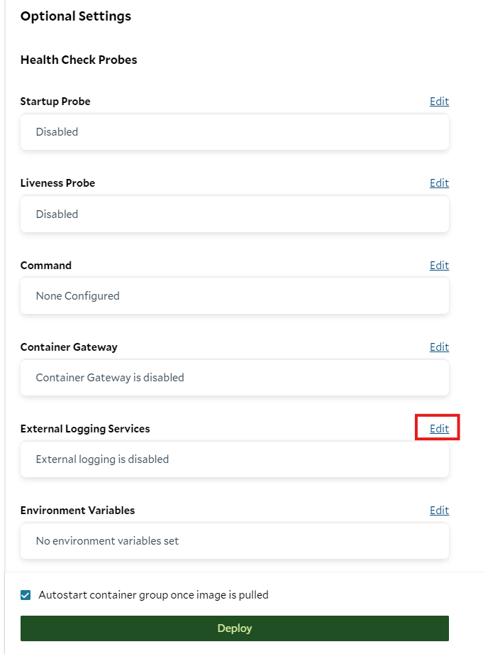
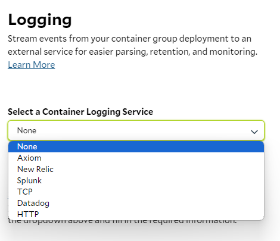
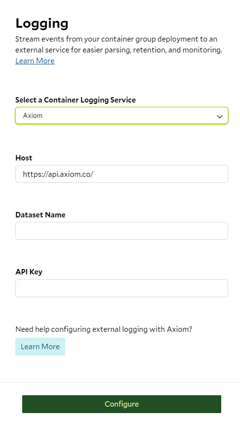

_Last Updated: November 12, 2026_

You may wish to stream event logs from your container group deployment to an external service for easier parsing,
retention, and monitoring. To configure external logging, click 'edit' on the External Logging Services section on the
Container Group Deployment page.

External logging is also the way to read logs continuously or in high volume. Reading logs through SaladCloud counts
against [daily log query limits](/container-engine/explanation/container-groups/container-logs#daily-log-query-limits),
but logs streamed to your own service arrive as they're written, with no polling and no SaladCloud query limit.

In the sidebar that appears, select the logging service you wish to use.

> ❓ Logging service not supported?
>
> We're working to expand the logging services supported on SaladCloud. If you're using an external logging service not
> listed here, please [get in touch](mailto:cloud@salad.com)!
>
> Under the hood, SaladCloud uses [Fluent Bit](https://docs.fluentbit.io/manual/pipeline/outputs) to collect and send
> container logs. Check the Fluent Bit documentation here to see if your preferred logging service is supported out of
> the box. If so, we can easily add support for it - just let us know.

Finally, fill out the form fields and press Configure.

> 📘 Don't have an external logging provider?
>
> Check out the [Container Logs](/container-engine/explanation/container-groups/container-logs) feature in the
> SaladCloud Portal.
