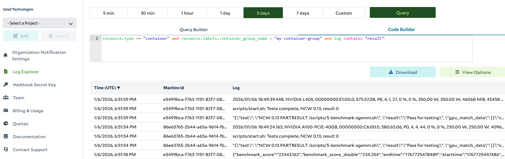

_Last Updated: November 12, 2026_

The Log Explorer provides access to container and system logs across all container groups, allowing you to run detailed
queries. Once you have selected an organization, the Log Explorer is accessible from the left menu. You can also access
it from the Container Logs or System Events tab of a Container Group, where the query will be pre-populated for the
group you were viewing

There are two interfaces for creating queries in the Log Explorer: the Query Builder and the Code Builder. The Query
Builder offers a simple graphical interface to build log queries without needing to know the
[Salad Log Query Language](https://docs.salad.com/container-engine/reference/log-queries). Use the dropdowns and input
fields to specify filters for your logs. The Code Builder allows you to write queries directly in the Salad Log Query
Language for more advanced capabilities.

After you run a query, the results are displayed in the table below the query interface.

Each query you run, and each auto-refresh, counts against your
[daily log query limits](/container-engine/explanation/container-groups/container-logs#daily-log-query-limits). If a
limit is reached, the Log Explorer shows a "Daily log query limit reached" banner and queries resume at 00:00 UTC.

